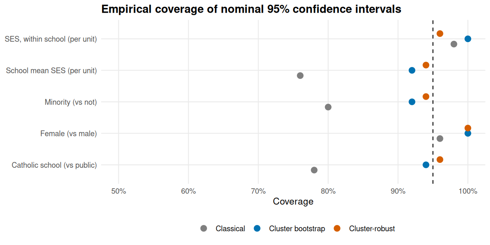
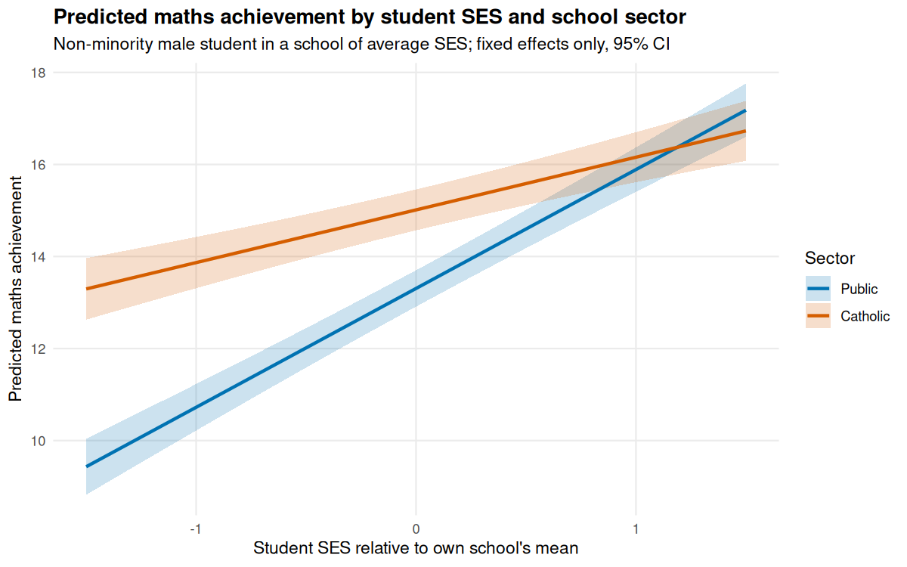

# Regression and Statistical Inference in R

A complete statistical analysis of the **High School and Beyond** survey (7,185 US students in 160 schools): what predicts mathematics achievement, and how much do the conclusions depend on handling the **students-within-schools** structure correctly?

The project covers linear regression, generalised linear models and mixed-effects models, with assumption checks at every stage, bootstrap confidence intervals, a simulation study of interval coverage, multiple-testing correction, and a written report.

**Read the report:** [`report.md`](report.md) (renders on GitHub) or download [`report.html`](report.html) for the table of contents and collapsible code.

| | |
|---|---|
| **Language / tools** | R 4.3, tidyverse, `lme4`, R Markdown (also `broom`, `broom.mixed`, `car`, `lmtest`, `sandwich`, `patchwork`) |
| **Data** | `nlme::MathAchieve` + `nlme::MathAchSchool` (education, 1982 US survey; ships with R, no download) |
| **Reproducible** | Fixed seeds, one command (`Rscript run_all.R`), tables and figures written to `outputs/` |

## Key findings

1. **Schools matter.** 18% of the variance in maths scores is between schools (ICC = 0.18, 95% bootstrap CI 0.14 to 0.22).
2. **Ignoring clustering gives overconfident inference.** Classical OLS standard errors for school-level predictors are about 1.7 times too small. In a 500-replicate simulation, nominal 95% intervals for the Catholic-sector effect and for school mean SES covered the truth only about 73 to 74% of the time, versus about 93 to 95% for cluster-robust and cluster-bootstrap intervals.
3. **Effects (final mixed model).** Minority status is associated with about 2.8 points lower achievement, female sex with about 1.2 lower, a school with one unit higher mean SES with about 4 points higher, and Catholic schools with about 1.7 points higher at average SES.
4. **The Catholic-school advantage depends on student SES.** The SES gradient is flatter in Catholic schools (cross-level interaction, LRT p < 0.001); the sector gap is clearest for lower-SES students and absent for high-SES non-minority students.
5. **Multiple testing changes the story.** Of 160 per-school slope tests, 12 are significant unadjusted (about 8 expected by chance) but at most 1 survives Holm, Bonferroni, BH or BY correction.
6. **GLM checks matter too.** A school-level binomial model is overdispersed (Pearson dispersion 2.3), so quasi-likelihood standard errors are used. A logistic GLMM confirms the logistic GLM's conclusions with wider, cluster-aware intervals for school-level predictors.

<p align="center">
  
  
</p>

## What the project demonstrates

| Skill | Where |
|---|---|
| Linear regression with full diagnostics (residual plots, Q-Q, scale-location, Cook's distance, VIF, Breusch-Pagan) | Report section 4 |
| Detecting and quantifying a violated independence assumption (residual ICC, design effect, robust vs classical SEs) | Section 5 |
| Linear mixed-effects models in `lme4`: random intercepts and slopes, cross-level interactions, ML vs REML, boundary-corrected LRTs, R², level-1 and level-2 diagnostics | Section 6 |
| GLMs: logistic regression (calibration, binned residuals, ROC/AUC, linearity of the logit), overdispersion and quasi-binomial, logistic GLMM, marginal vs conditional odds ratios | Section 7 |
| Bootstrap confidence intervals: cluster vs naive case bootstrap, parametric bootstrap for mixed models, bootstrap CI for the ICC, profile and Wald comparison | Section 8 |
| Simulation study of CI coverage | Section 8.4 |
| Multiple-testing correction: Bonferroni, Holm (FWER), Benjamini-Hochberg, Benjamini-Yekutieli (FDR) on two families of tests | Section 9 |
| Clear interpretation, limitations and non-causal framing | Sections 6, 10 |

## Repository structure

```
regression-inference-r/
├── report.Rmd              # the analysis and written report (source)
├── report.md / report.html # rendered report
├── run_all.R               # reproduces everything
├── install_packages.R      # installs the CRAN packages used
├── R/
│   ├── 00_setup.R          # packages, seed, bootstrap sizes, plotting theme
│   ├── data.R              # data loading and preparation, data dictionary
│   ├── diagnostics.R       # lm / glm / mixed-model diagnostic helpers
│   └── inference.R         # cluster bootstrap, robust SEs, coverage simulation, p-value adjustment
├── data/                   # analysis data set and data dictionary (CSV)
├── outputs/
│   ├── figures/            # all figures (PNG)
│   └── tables/             # all result tables (CSV)
└── tests/smoke_test.R      # quick sanity checks for the helper functions
```

## How to run

```bash
git clone https://github.com/Fariha12t/regression-inference-r.git
cd regression-inference-r
Rscript install_packages.R        # once
Rscript run_all.R                 # full run, about 1-2 minutes
Rscript tests/smoke_test.R        # optional sanity checks
```

A quick run with smaller bootstrap sizes:

```bash
N_BOOT_CLUSTER=200 N_BOOT_PARAM=100 N_SIM_COVERAGE=50 Rscript run_all.R
```

Rendering to HTML needs [Pandoc](https://pandoc.org/) (bundled with RStudio). The project was developed with R 4.3.3; the report ends with a full `sessionInfo()`.

## Notes on the data and design choices

* **Data:** the High School and Beyond survey as distributed in `nlme` (Raudenbush & Bryk, 2002, *Hierarchical Linear Models*). Student SES is split into within-school and between-school parts so each effect is estimated separately.
* **Binary outcome:** "top-quartile achiever" is derived from the continuous score purely to demonstrate GLMs. The linear mixed models are the primary analysis.
* **Limitations:** observational, 1982 data, no survey weights, and no causal interpretation of the sector effect. See report section 10.

## Optional: publish the HTML report with GitHub Pages

In the repository, go to Settings, then Pages, choose "Deploy from a branch", select `main` and `/ (root)`. The report will then be available at `https://<your-username>.github.io/regression-inference-r/report.html`.

## License

MIT, see [LICENSE](LICENSE).
