# 1. Summary

**Question.** Which student and school characteristics are associated with mathematics achievement, and how much does the answer depend on correctly handling the fact that students are nested inside schools?

**Data.** The High School and Beyond (HSB) survey: 7,185 US high-school students in 160 schools (90 public, 70 Catholic), a classic multilevel education dataset shipped with R's `nlme` package.

**Methods.** Linear regression with full assumption checks, logistic and quasi-binomial GLMs, linear and generalised linear mixed-effects models (`lme4`), cluster and parametric bootstrap confidence intervals, a simulation study of CI coverage, and multiple-testing correction (Bonferroni, Holm, Benjamini-Hochberg, Benjamini-Yekutieli).

**Key findings**

1. **Schools matter, and ignoring them misleads.** About 18% of the variance in maths scores lies *between* schools (ICC = 0.18). An ordinary regression gives standard errors for school-level predictors that are about 1.7 times too small. In a simulation, its nominal 95% intervals for the Catholic-sector effect and for school mean SES covered the truth only about three times in four, while cluster-robust, cluster-bootstrap and mixed-model intervals were close to nominal (Section 8.4).
2. **SES, sector, minority status and sex are all associated with achievement** after adjustment. In the final mixed model, a student whose SES is one unit above their school's average scores about 2.6 points higher in a public school (and about 1.1 points higher in a Catholic school); a school with one unit higher average SES has students scoring about 4 points higher; Catholic-school students score about 1.7 points higher at average SES; minority students about 2.8 points lower; female students about 1.2 points lower.
3. **The Catholic-school advantage is not uniform.** The SES gradient is flatter in Catholic schools, and the sector gap is concentrated among lower- and middle-SES students (Sections 6.4 and 9.2).
4. **Once sector and school SES are modelled, there is no evidence that schools differ in their SES slopes.** A random slope adds nothing (p = 0.95), and of 160 per-school slope tests at most one survives multiplicity correction, against 12 unadjusted rejections (Section 9.1). Multiple-testing corrections also matter for the 12 subgroup comparisons of the sector gap (Section 9.2).
5. **Dichotomising the outcome tells the same story** (top-quartile achievement), with the same ordering of effects (Section 7). The school-level binomial model shows clear overdispersion, so quasi-likelihood standard errors are used.

All results are associations in observational survey data, not causal effects (Section 10).

# 2. Data

The data come from the `nlme` package, so no download is needed. Student-level variables (`MathAch`, `SES`, `Minority`, `Sex`) are joined to school-level variables (`Sector`, `Size`, `PRACAD`, `DISCLIM`, `HIMINTY`). Student SES is split into a **within-school** part (`ses_c`, the student's SES relative to their own school's mean) and a **between-school** part (`ses_mean`, the school mean). This separates two effects that a single SES term mixes together.


```r
hsb    <- load_hsb()
cutoff <- attr(hsb, "cutoff")

dd <- data_dictionary()
readr::write_csv(dd,  "data/data_dictionary.csv")
readr::write_csv(hsb, "data/hsb_analysis.csv")
knitr::kable(dd, caption = "Data dictionary")
```


Table: Data dictionary

|variable |level   |description                                                  |
|:--------|:-------|:------------------------------------------------------------|
|School   |school  |School identifier (160 schools)                              |
|MathAch  |student |Mathematics achievement score (outcome, continuous)          |
|SES      |student |Socio-economic status index (roughly centred at 0)           |
|ses_c    |student |SES minus own school's mean SES (within-school SES)          |
|ses_mean |school  |School mean SES (between-school SES)                         |
|Minority |student |Ethnic minority status (No/Yes)                              |
|Sex      |student |Male/Female                                                  |
|Sector   |school  |Public or Catholic                                           |
|Size     |school  |School enrolment                                             |
|PRACAD   |school  |Proportion of students on the academic track                 |
|DISCLIM  |school  |Disciplinary climate scale (higher = worse climate)          |
|HIMINTY  |school  |High-minority-enrolment school (0/1)                         |
|n_school |school  |Students sampled in the school                               |
|high_ach |student |1 if MathAch is in the top quartile (derived binary outcome) |

There are no missing values, 7185 students, 160 schools and on average 44.9 sampled students per school. For the logistic models, "high achiever" means a score of at least 18.3 (the top quartile; prevalence 25.0%).

# 3. Exploratory analysis


```r
desc <- hsb |>
  group_by(Sector) |>
  summarise(Schools = n_distinct(School), Students = n(),
            `Mean maths` = mean(MathAch), `SD maths` = sd(MathAch),
            `Mean SES` = mean(SES), `% minority` = 100 * mean(Minority == "Yes"),
            `% female` = 100 * mean(Sex == "Female"),
            `% top quartile` = 100 * mean(high_ach))
save_table(desc, "01_descriptives_by_sector")
knitr::kable(desc, digits = 2, caption = "Descriptive statistics by school sector")
```


Table: Descriptive statistics by school sector

|Sector   | Schools| Students| Mean maths| SD maths| Mean SES| % minority| % female| % top quartile|
|:--------|-------:|--------:|----------:|--------:|--------:|----------:|--------:|--------------:|
|Public   |      90|     3642|      11.36|     7.08|    -0.15|      25.29|    52.50|          20.07|
|Catholic |      70|     3543|      14.17|     6.36|     0.15|      29.72|    53.15|          30.09|


```r
school_df <- hsb |>
  group_by(School, Sector) |>
  summarise(mean_math = mean(MathAch), ses_mean = first(ses_mean), n = n(), .groups = "drop")

p_a <- ggplot(hsb, aes(MathAch)) +
  geom_histogram(bins = 40, fill = "grey60", colour = "white") +
  labs(title = "A. Distribution of maths achievement", x = "Maths achievement", y = "Students")
p_b <- ggplot(hsb, aes(Sector, MathAch, fill = Sector)) +
  geom_violin(alpha = .5, colour = NA) +
  geom_boxplot(width = .15, outlier.shape = NA, fill = "white") +
  scale_fill_manual(values = SECTOR_COLS) + guides(fill = "none") +
  labs(title = "B. By school sector", x = NULL, y = "Maths achievement")
p_c <- ggplot(hsb, aes(SES, MathAch, colour = Sector)) +
  geom_point(alpha = .12, size = .7) +
  geom_smooth(method = "lm", se = FALSE) +
  scale_colour_manual(values = SECTOR_COLS) +
  labs(title = "C. Student SES vs achievement", x = "SES", y = "Maths achievement")
p_d <- ggplot(school_df, aes(ses_mean, mean_math, colour = Sector)) +
  geom_point(aes(size = n), alpha = .7) +
  geom_smooth(method = "lm", se = FALSE) +
  scale_colour_manual(values = SECTOR_COLS) + scale_size(range = c(1, 4), guide = "none") +
  guides(colour = "none") +
  labs(title = "D. School means", x = "School mean SES", y = "School mean maths")

(p_a | p_b) / (p_c | p_d) + plot_layout(guides = "collect") & theme(legend.position = "bottom")
```

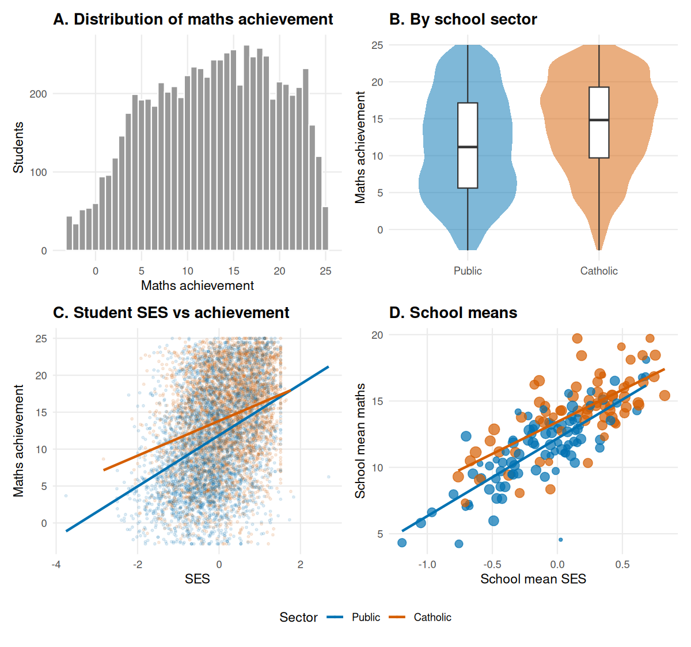

Achievement is bounded (a ceiling near 25) and broadly spread. Catholic schools have higher average scores, and school mean achievement rises steeply with school mean SES (panel D). The within-sector SES lines in panel C are flatter for Catholic schools, which previews the interaction modelled later.

**How much variation is between schools?** An empty ("null") random-intercept model splits the variance into a between-school part and a within-school part:


```r
m0 <- lmer(MathAch ~ 1 + (1 | School), data = hsb, REML = TRUE)
vc0 <- as.data.frame(VarCorr(m0))
icc0 <- icc_from_vc(vc0$vcov[1], vc0$vcov[2])
knitr::kable(
  tibble(Component = c("Between schools", "Within schools (students)"),
         Variance = vc0$vcov, `SD` = vc0$sdcor),
  digits = 2, caption = sprintf("Variance decomposition of maths achievement; ICC = %.3f", icc0))
```


Table: Variance decomposition of maths achievement; ICC = 0.180

|Component                 | Variance|   SD|
|:-------------------------|--------:|----:|
|Between schools           |     8.61| 2.93|
|Within schools (students) |    39.15| 6.26|

The intraclass correlation is **0.18**: 18% of the total variance is between schools. With about 45 students per school, the design effect for a school-level quantity is roughly $1 + (m-1)\rho \approx$ 8.9, so observations within a school are far from independent. Section 4 shows how this matters for the standard regression.

# 4. Linear regression

## 4.1 Model

The baseline model treats all students as independent:

$$\text{MathAch}_{ij} = \beta_0 + \beta_1\,\text{SES}^{\text{within}}_{ij} + \beta_2\,\overline{\text{SES}}_j + \beta_3\,\text{Minority}_{ij} + \beta_4\,\text{Female}_{ij} + \beta_5\,\text{Catholic}_j + \varepsilon_{ij}$$


```r
f_lm <- MathAch ~ ses_c + ses_mean + Minority + Sex + Sector
m_lm <- lm(f_lm, data = hsb)

lm_tab <- broom::tidy(m_lm, conf.int = TRUE) |>
  transmute(Term = pretty_term(term), Estimate = estimate, SE = std.error,
            `95% CI low` = conf.low, `95% CI high` = conf.high, p = p_fmt(p.value))
save_table(lm_tab, "02_ols_coefficients")
knitr::kable(lm_tab, digits = 2, caption = "OLS coefficients (classical standard errors)")
```


Table: OLS coefficients (classical standard errors)

|Term                          | Estimate|   SE| 95% CI low| 95% CI high|p      |
|:-----------------------------|--------:|----:|----------:|-----------:|:------|
|Intercept                     |    13.34| 0.13|      13.08|       13.60|<0.001 |
|SES, within school (per unit) |     1.92| 0.11|       1.71|        2.14|<0.001 |
|School mean SES (per unit)    |     3.93| 0.20|       3.53|        4.32|<0.001 |
|Minority (vs not)             |    -2.71| 0.18|      -3.05|       -2.36|<0.001 |
|Female (vs male)              |    -1.37| 0.15|      -1.66|       -1.09|<0.001 |
|Catholic school (vs public)   |     1.77| 0.16|       1.47|        2.08|<0.001 |

The model explains 20.6% of the variance in achievement (adjusted $R^2$ = 0.205; residual SD 6.13).

## 4.2 Assumption checks


```r
diag_plots_lm(m_lm)
```

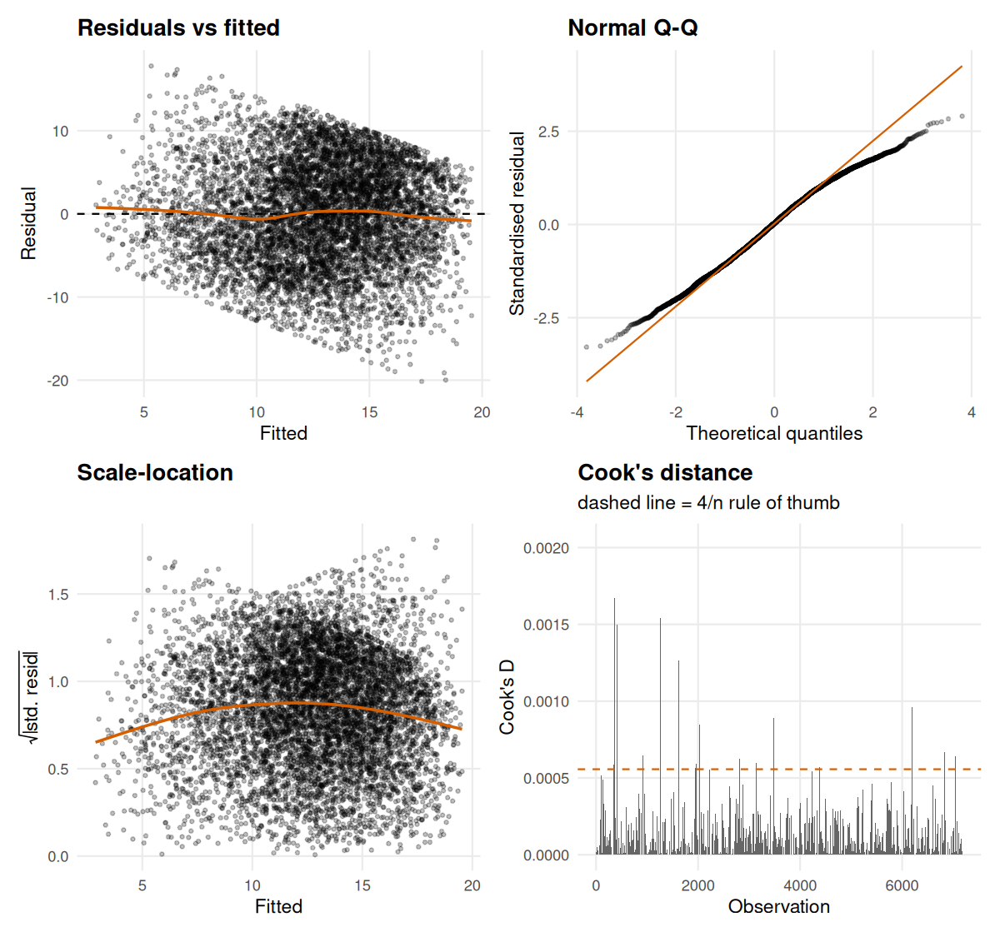


```r
lm_checks <- lm_assumption_tests(m_lm)
save_table(lm_checks, "03_ols_assumption_checks")
knitr::kable(lm_checks, col.names = c("Check", "Result"))
```


|Check                             |Result                       |
|:---------------------------------|:----------------------------|
|Breusch-Pagan (constant variance) |BP = 55.4, df = 5, p < 0.001 |
|Skewness of residuals             |-0.17                        |
|Excess kurtosis of residuals      |-0.53                        |
|Max Cook's distance               |0.0021                       |
|Max VIF                           |1.32                         |

* **Linearity.** The residual-vs-fitted smoother is essentially flat, so there is no sign of curvature in the mean function.
* **Normality.** The Q-Q plot shows lighter-than-normal tails (excess kurtosis about -0.53), which is expected for a bounded score with ceiling effects. Skewness is small. With 7,185 observations the central limit theorem makes the coefficient estimates robust to this.
* **Constant variance.** The Breusch-Pagan test rejects (as large samples tend to), and the scale-location smoother is a mild inverted U: residual spread is somewhat smaller at the extremes of the fitted values, as expected for a bounded score. The effect is small in practice, because heteroscedasticity-robust (HC3) standard errors are almost identical to the classical ones (Section 5).
* **Influence.** Cook's distances are tiny in absolute terms (maximum about 0.0021, against conventional concern thresholds of 0.5 to 1). The 4/n guideline flags some points, as it always does in a large sample, but no single student drives the fit.
* **Collinearity.** All VIFs are small (maximum 1.32).
* **Independence.** This is the assumption that fails, and the one the diagnostic plots cannot show. The next section tests it directly.

# 5. Independence fails: standard errors under clustering

If students in the same school resemble each other beyond what the predictors explain, OLS residuals are correlated within schools. Fitting a null model to the OLS residuals measures that correlation:


```r
resid_df <- tibble(r = resid(m_lm), School = hsb$School)
m_resid  <- lmer(r ~ 1 + (1 | School), data = resid_df)
vcr      <- as.data.frame(VarCorr(m_resid))
icc_resid <- icc_from_vc(vcr$vcov[1], vcr$vcov[2])
m_bar     <- nrow(hsb) / n_distinct(hsb$School)
deff_pred <- sqrt(1 + (m_bar - 1) * icc_resid)
```

The residual ICC is **0.046**. Even after adjusting for SES, minority status, sex and sector, about 4.6% of residual variance is between schools. For predictors that are constant within a school the standard-error inflation factor is approximately $\sqrt{1+(\bar m-1)\rho}$ = **1.74**.

The table compares four standard errors for the *same* OLS point estimates. The last column is the ratio of cluster-robust to classical SE.


```r
se_cmp <- se_table_ols(m_lm, cluster = hsb$School) |>
  mutate(ratio = se_cluster / se_naive)

m1_reml <- lmer(MathAch ~ ses_c + ses_mean + Minority + Sex + Sector + (1 | School),
                data = hsb, REML = TRUE, control = LMER_CTRL)
se_cmp$se_lmm <- unname(summary(m1_reml)$coefficients[se_cmp$term, "Std. Error"])

se_out <- se_cmp |>
  transmute(Term = pretty_term(term), Estimate = estimate,
            `Classical SE` = se_naive, `HC3 SE` = se_hc3,
            `Cluster-robust SE` = se_cluster, `Mixed-model SE` = se_lmm,
            `Cluster / classical` = ratio)
save_table(se_out, "04_standard_error_comparison")
knitr::kable(se_out, digits = 3, caption = "Standard errors for the same coefficients under different assumptions")
```


Table: Standard errors for the same coefficients under different assumptions

|Term                          | Estimate| Classical SE| HC3 SE| Cluster-robust SE| Mixed-model SE| Cluster / classical|
|:-----------------------------|--------:|------------:|------:|-----------------:|--------------:|-------------------:|
|Intercept                     |   13.341|        0.134|  0.141|             0.202|          0.202|               1.515|
|SES, within school (per unit) |    1.923|        0.111|  0.111|             0.122|          0.108|               1.101|
|School mean SES (per unit)    |    3.927|        0.201|  0.198|             0.348|          0.343|               1.730|
|Minority (vs not)             |   -2.707|        0.175|  0.173|             0.264|          0.201|               1.505|
|Female (vs male)              |   -1.373|        0.145|  0.146|             0.199|          0.159|               1.367|
|Catholic school (vs public)   |    1.775|        0.158|  0.158|             0.273|          0.278|               1.730|


```r
t_crit <- qt(.975, df = n_distinct(hsb$School) - 1)
ci_cmp <- bind_rows(
  se_cmp |> transmute(term, Method = "OLS, classical SE", estimate,
                      low = estimate - 1.96 * se_naive, high = estimate + 1.96 * se_naive),
  se_cmp |> transmute(term, Method = "OLS, cluster-robust SE", estimate,
                      low = estimate - t_crit * se_cluster, high = estimate + t_crit * se_cluster)
) |>
  filter(term != "(Intercept)") |>
  mutate(Term = pretty_term(term))

ggplot(ci_cmp, aes(estimate, Term, colour = Method)) +
  geom_vline(xintercept = 0, linetype = 2, colour = "grey50") +
  geom_pointrange(aes(xmin = low, xmax = high), position = position_dodge(width = .5)) +
  scale_colour_manual(values = c("OLS, classical SE" = "grey50", "OLS, cluster-robust SE" = "#D55E00")) +
  labs(title = "Same estimates, honest uncertainty",
       subtitle = "Classical intervals are too narrow, most of all for school-level predictors",
       x = "Coefficient (maths points)", y = NULL, colour = NULL) +
  theme(legend.position = "bottom")
```

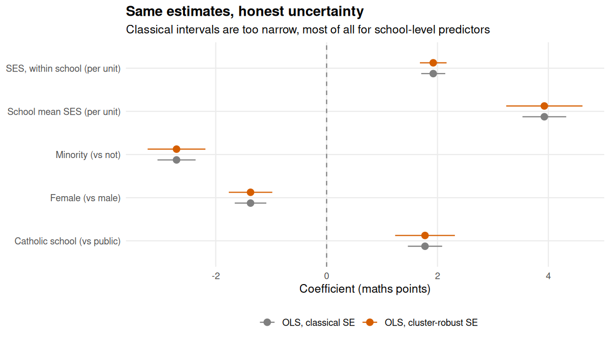

The two school-level predictors, school mean SES and sector, have cluster-robust SEs 1.73 and 1.73 times the classical ones, matching the predicted 1.74. The within-school SES coefficient is barely affected (ratio 1.1), because SES varies *within* schools. Point estimates do not change; the problem is that classical inference is overconfident. The mixed-effects model in the next section builds the school structure into the model itself.

# 6. Linear mixed-effects models

## 6.1 Model building

Four nested or related models are fitted by maximum likelihood (needed to compare models with different fixed effects):

* **M1**: random intercept per school, same fixed effects as OLS.
* **M2**: M1 plus a random slope for within-school SES (the SES gradient may differ by school).
* **M3a**: M1 plus *cross-level interactions*: the SES gradient may depend on sector and on school mean SES.
* **M3b**: M3a plus the random slope.


```r
m1  <- lmer(MathAch ~ ses_c + ses_mean + Minority + Sex + Sector + (1 | School),
            data = hsb, REML = FALSE, control = LMER_CTRL)
m2  <- lmer(MathAch ~ ses_c + ses_mean + Minority + Sex + Sector + (1 + ses_c | School),
            data = hsb, REML = FALSE, control = LMER_CTRL)
m3a <- lmer(MathAch ~ ses_c * Sector + ses_c * ses_mean + Minority + Sex + (1 | School),
            data = hsb, REML = FALSE, control = LMER_CTRL)
m3b <- lmer(MathAch ~ ses_c * Sector + ses_c * ses_mean + Minority + Sex + (1 + ses_c | School),
            data = hsb, REML = FALSE, control = LMER_CTRL)

fits <- list(M1 = m1, M2 = m2, M3a = m3a, M3b = m3b)
stopifnot(!any(sapply(fits, isSingular)))   # no boundary fits

ic <- tibble(Model = names(fits),
             Parameters = sapply(fits, function(m) attr(logLik(m), "df")),
             logLik = sapply(fits, function(m) as.numeric(logLik(m))),
             AIC = sapply(fits, AIC), BIC = sapply(fits, BIC))
knitr::kable(ic, digits = 1, caption = "Information criteria (lower is better)")
```


Table: Information criteria (lower is better)

|Model | Parameters| logLik|   AIC|   BIC|
|:-----|----------:|------:|-----:|-----:|
|M1    |          8| -23149| 46314| 46370|
|M2    |         10| -23147| 46313| 46382|
|M3a   |         10| -23129| 46278| 46346|
|M3b   |         12| -23129| 46282| 46364|

Three targeted likelihood-ratio tests answer separate questions. Tests of variance components sit on the boundary of the parameter space (a variance cannot be negative), so the usual $\chi^2$ reference distribution is conservative; the random-slope test uses the 50:50 mixture of $\chi^2_1$ and $\chi^2_2$.


```r
lrt <- function(small, big) 2 * as.numeric(logLik(big) - logLik(small))
s_rs   <- lrt(m1,  m2)     # random slope alone
s_int  <- lrt(m1,  m3a)    # cross-level interactions (2 df)
s_rs2  <- lrt(m3a, m3b)    # random slope, given interactions

lrt_tab <- tibble(
  Question = c("Do SES slopes vary randomly across schools? (M1 vs M2)",
               "Do sector and school SES moderate the SES slope? (M1 vs M3a)",
               "Do slopes still vary after those interactions? (M3a vs M3b)"),
  `LR statistic` = c(s_rs, s_int, s_rs2),
  df = c("1 + 1 (boundary)", "2", "1 + 1 (boundary)"),
  p = c(p_boundary_lrt(s_rs), pchisq(s_int, 2, lower.tail = FALSE), p_boundary_lrt(s_rs2))
) |> mutate(p = p_fmt(p))
save_table(lrt_tab, "05_lrt_model_comparison")
knitr::kable(lrt_tab, digits = 2)
```


|Question                                                     | LR statistic|df               |p      |
|:------------------------------------------------------------|------------:|:----------------|:------|
|Do SES slopes vary randomly across schools? (M1 vs M2)       |         5.19|1 + 1 (boundary) |0.049  |
|Do sector and school SES moderate the SES slope? (M1 vs M3a) |        40.87|2                |<0.001 |
|Do slopes still vary after those interactions? (M3a vs M3b)  |         0.02|1 + 1 (boundary) |0.947  |

Read together: a random slope looks marginally useful *on its own* (p about 0.05), but that variation is explained by systematic differences between sectors and by school SES. The interactions improve fit decisively (and give the lowest AIC and BIC), after which a random slope adds nothing (p = 0.947). **M3a is the final model**, refitted with REML for unbiased variance estimates.

## 6.2 Final model

$$\text{MathAch}_{ij} = \gamma_{00} + \gamma_{10}\,\text{ses}^{c}_{ij} + \gamma_{01}\,\overline{\text{SES}}_j + \gamma_{02}\,\text{Catholic}_j + \gamma_{11}\,\text{ses}^{c}_{ij}\!\times\!\text{Catholic}_j + \gamma_{12}\,\text{ses}^{c}_{ij}\!\times\!\overline{\text{SES}}_j + \gamma_{\cdot}\,\mathbf{x}_{ij} + u_{0j} + \varepsilon_{ij}$$

with $u_{0j}\sim N(0,\tau^2)$ and $\varepsilon_{ij}\sim N(0,\sigma^2)$.


```r
m_final <- update(m3a, REML = TRUE)

fx <- broom.mixed::tidy(m_final, effects = "fixed", conf.int = TRUE, conf.method = "Wald") |>
  transmute(Term = pretty_term(term), Estimate = estimate, SE = std.error,
            `95% CI low` = conf.low, `95% CI high` = conf.high, `t` = statistic)
save_table(fx, "06_lmm_fixed_effects")
knitr::kable(fx, digits = 2, caption = "Final mixed model: fixed effects (Wald 95% CIs; bootstrap and profile intervals in Section 8)")
```


Table: Final mixed model: fixed effects (Wald 95% CIs; bootstrap and profile intervals in Section 8)

|Term                                | Estimate|   SE| 95% CI low| 95% CI high|      t|
|:-----------------------------------|--------:|----:|----------:|-----------:|------:|
|Intercept                           |    13.31| 0.20|      12.91|       13.70|  65.93|
|SES, within school (per unit)       |     2.58| 0.15|       2.29|        2.88|  17.12|
|Catholic school (vs public)         |     1.71| 0.28|       1.16|        2.25|   6.15|
|School mean SES (per unit)          |     4.05| 0.34|       3.38|        4.72|  11.80|
|Minority (vs not)                   |    -2.77| 0.20|      -3.17|       -2.38| -13.79|
|Female (vs male)                    |    -1.22| 0.16|      -1.54|       -0.91|  -7.71|
|Within-school SES x Catholic        |    -1.44| 0.23|      -1.89|       -0.99|  -6.25|
|Within-school SES x School mean SES |     1.00| 0.29|       0.44|        1.56|   3.49|

```r
vc_final <- as.data.frame(VarCorr(m_final))
tau2 <- vc_final$vcov[1]; sig2 <- vc_final$vcov[2]
icc_final <- icc_from_vc(tau2, sig2)
r2 <- r2_nakagawa(m_final)
```

Between-school SD of intercepts is 1.34 and within-school residual SD is 5.98. After adjustment the **residual ICC is 0.048**, down from 0.18 in the null model: school mean SES and sector explain most, but not all, of the between-school variation. Marginal $R^2$ (fixed effects only) is 0.213 and conditional $R^2$ (fixed + random) is 0.25.

**Coefficient interpretation** (all else equal; both SES measures are centred near zero, so main effects refer to a student with average SES in a school with average SES):

* A student whose SES is **1 unit above their school's average** scores about 2.6 points higher in a public school (one SD of SES is about 0.78 units).
* In **Catholic schools that gradient is flatter** by about 1.4 points per unit: the achievement gap between higher- and lower-SES students is smaller.
* The gradient is **steeper in schools with higher mean SES** (interaction coefficient 1.00).
* A school with **1 unit higher mean SES** has students scoring about 4.1 points higher, comparing students with the same own-SES relative to school mean.
* **Minority** students score about 2.8 points lower and **female** students about 1.2 points lower on average, conditional on the other variables.
* The **Catholic-sector main effect** (1.71) applies at average SES; the sector difference changes with student SES (next figure).

## 6.3 Diagnostics for the mixed model


```r
plot_lmm_diagnostics(m_final)
```

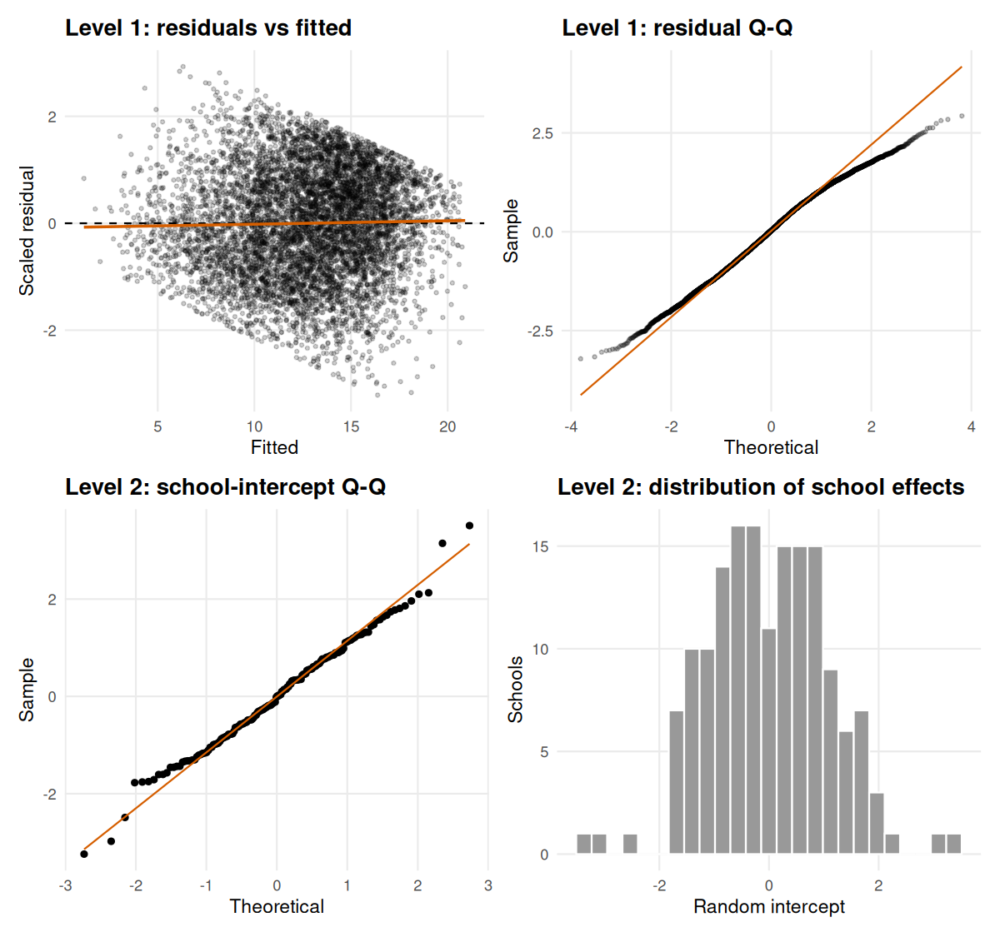

Level-1 residuals show no pattern against fitted values and are close to normal, apart from the light tails noted earlier. At level 2, the school-intercept Q-Q plot follows the reference line closely apart from a handful of schools in the tails (about five of 160), and the distribution of school effects is roughly symmetric, so the normal random-effects assumption is reasonable. No convergence or singularity warnings occurred.

## 6.4 The sector difference depends on student SES


```r
grid <- expand_grid(ses_c = seq(-1.5, 1.5, length.out = 60),
                    Sector = factor(c("Public", "Catholic"), levels = c("Public", "Catholic"))) |>
  mutate(ses_mean = 0, Minority = factor("No", levels = c("No", "Yes")),
         Sex = factor("Male", levels = c("Male", "Female")))

X  <- model.matrix(delete.response(terms(m_final, fixed.only = TRUE)), grid)
V  <- as.matrix(vcov(m_final))
grid <- grid |>
  mutate(fit = as.vector(X %*% fixef(m_final)),
         se  = sqrt(rowSums((X %*% V) * X)),
         lo = fit - 1.96 * se, hi = fit + 1.96 * se)

ggplot(grid, aes(ses_c, fit, colour = Sector, fill = Sector)) +
  geom_ribbon(aes(ymin = lo, ymax = hi), alpha = .2, colour = NA) +
  geom_line(linewidth = 1) +
  scale_colour_manual(values = SECTOR_COLS) + scale_fill_manual(values = SECTOR_COLS) +
  labs(title = "Predicted maths achievement by student SES and school sector",
       subtitle = "Non-minority male student in a school of average SES; fixed effects only, 95% CI",
       x = "Student SES relative to own school's mean", y = "Predicted maths achievement")
```

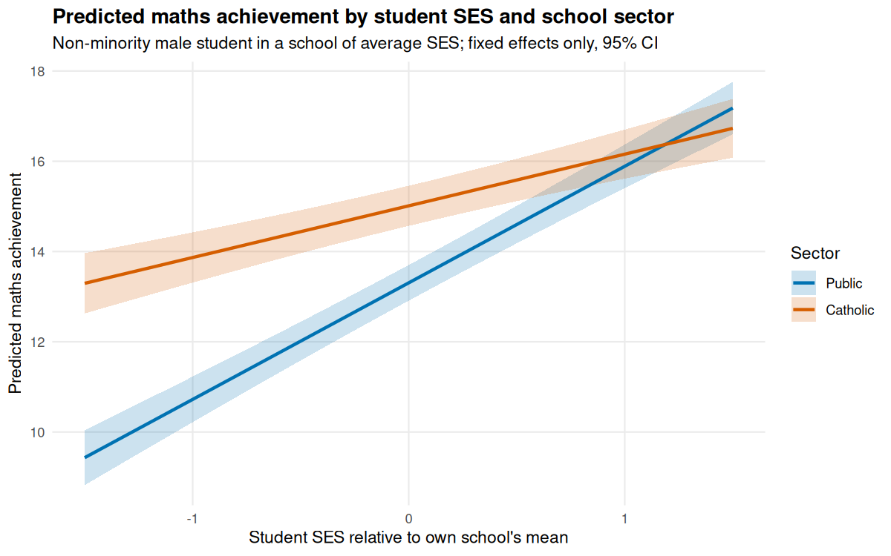

For a student 1.5 units below their school's mean SES the predicted Catholic advantage is about 4 points; it shrinks steadily as student SES rises and the two lines cross at roughly one unit above the school mean, because the Catholic-school SES gradient is flatter. This is the pattern revisited with formal multiplicity control in Section 9.2.

# 7. Generalised linear models

## 7.1 Student-level logistic regression

The outcome is "top-quartile achiever" (`high_ach`), modelled with a binomial GLM and logit link. (Dichotomising the score throws away information; it is used here to demonstrate the GLM workflow and check that conclusions are robust to the outcome definition.)


```r
f_glm <- high_ach ~ ses_c + ses_mean + Minority + Sex + Sector
g1 <- glm(f_glm, family = binomial, data = hsb)

or_tab <- broom::tidy(g1, conf.int = TRUE, exponentiate = TRUE) |>
  filter(term != "(Intercept)") |>
  transmute(Term = pretty_term(term), `Odds ratio` = estimate,
            `95% CI low` = conf.low, `95% CI high` = conf.high, p = p_fmt(p.value))
save_table(or_tab, "07_logistic_odds_ratios")
knitr::kable(or_tab, digits = 2, caption = "Logistic regression: odds ratios with profile-likelihood 95% CIs")
```


Table: Logistic regression: odds ratios with profile-likelihood 95% CIs

|Term                          | Odds ratio| 95% CI low| 95% CI high|p      |
|:-----------------------------|----------:|----------:|-----------:|:------|
|SES, within school (per unit) |       1.66|       1.52|        1.82|<0.001 |
|School mean SES (per unit)    |       2.86|       2.42|        3.38|<0.001 |
|Minority (vs not)             |       0.38|       0.33|        0.45|<0.001 |
|Female (vs male)              |       0.59|       0.53|        0.66|<0.001 |
|Catholic school (vs public)   |       1.40|       1.24|        1.59|<0.001 |

Odds ratios are multiplicative: for example, minority students have about 62% lower odds of being a top-quartile achiever than non-minority students, other things equal, and Catholic-school students have about 40% higher odds.

## 7.2 GLM diagnostics


```r
p_hat <- fitted(g1)
roc   <- roc_curve(hsb$high_ach, p_hat)
auc_g1 <- auc(hsb$high_ach, p_hat)

p_roc <- ggplot(roc, aes(fpr, tpr)) + geom_abline(linetype = 2, colour = "grey50") +
  geom_line(linewidth = 1, colour = "#0072B2") + coord_equal() +
  labs(title = sprintf("ROC curve (AUC = %.2f)", auc_g1),
       x = "False-positive rate", y = "True-positive rate")
(plot_calibration(hsb$high_ach, p_hat, "Calibration (deciles)") |
   plot_binned_residuals(g1, "Binned residuals") | p_roc)
```

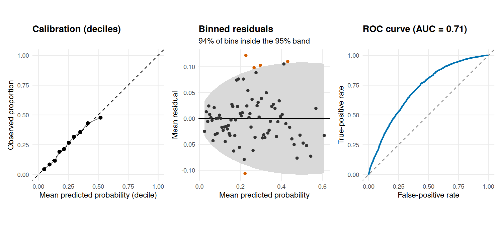


```r
g1_quad <- update(g1, . ~ . + I(ses_c^2) + I(ses_mean^2))
lin_lrt <- anova(g1, g1_quad, test = "LRT")
bres <- binned_residuals(g1)

glm_checks <- tibble(
  Check = c("Linearity of the logit (add quadratic SES terms, LRT)",
            "Max VIF", "Max Cook's distance",
            "Share of binned residuals inside the 95% band", "AUC (discrimination)"),
  Result = c(sprintf("chi2(2) = %.2f, p = %.2f", lin_lrt$Deviance[2], lin_lrt$`Pr(>Chi)`[2]),
             sprintf("%.2f", max(car::vif(g1))), sprintf("%.4f", max(cooks.distance(g1))),
             sprintf("%.0f%%", 100 * mean(abs(bres$r_mean) <= 2 * bres$se)),
             sprintf("%.2f", auc_g1)))
save_table(glm_checks, "08_logistic_checks")
knitr::kable(glm_checks)
```


|Check                                                 |Result                   |
|:-----------------------------------------------------|:------------------------|
|Linearity of the logit (add quadratic SES terms, LRT) |chi2(2) = 0.04, p = 0.98 |
|Max VIF                                               |1.22                     |
|Max Cook's distance                                   |0.0023                   |
|Share of binned residuals inside the 95% band         |94%                      |
|AUC (discrimination)                                  |0.71                     |

Calibration is good (observed proportions track predictions across deciles), about 94% of binned residuals sit inside their 95% bands (as expected), the quadratic terms add nothing (the logit is linear in SES), and there are no influential points or collinearity problems. The AUC of about 0.71 indicates modest discrimination, which is expected: four demographic and school variables cannot predict individual scores precisely. Overall the model is well specified for what it describes; its remaining weakness is again **independence**, addressed in Section 7.4.

## 7.3 School-level binomial GLM and overdispersion

A second GLM works at the school level: the number of top-quartile students out of those sampled, modelled from school characteristics. This is where the GLM dispersion check matters.


```r
sch <- hsb |>
  group_by(School) |>
  summarise(n = n(), n_high = sum(high_ach), ses_mean = first(ses_mean), Sector = first(Sector),
            PRACAD = first(PRACAD), DISCLIM = first(DISCLIM), HIMINTY = factor(first(HIMINTY)),
            Size_1000 = first(Size) / 1000, .groups = "drop")

f_sch <- cbind(n_high, n - n_high) ~ ses_mean + Sector + PRACAD + DISCLIM + HIMINTY + Size_1000
gs_bin <- glm(f_sch, family = binomial,      data = sch)
gs_qb  <- glm(f_sch, family = quasibinomial, data = sch)
disp <- sum(residuals(gs_bin, "pearson")^2) / df.residual(gs_bin)

sch_tab <- full_join(
  broom::tidy(gs_bin) |> select(term, `Binomial SE` = std.error, `Binomial p` = p.value),
  broom::tidy(gs_qb)  |> select(term, `Odds ratio` = estimate, `Quasi SE` = std.error, `Quasi p` = p.value),
  by = "term") |>
  mutate(`Odds ratio` = exp(`Odds ratio`), Term = c("Intercept", "School mean SES", "Catholic (vs public)",
         "Academic-track share", "Disciplinary climate", "High-minority school", "Enrolment (per 1,000)")) |>
  filter(term != "(Intercept)") |>
  transmute(Term, `Odds ratio`, `Binomial SE`, `Quasi SE`,
            `Binomial p` = p_fmt(`Binomial p`), `Quasi p` = p_fmt(`Quasi p`))
save_table(sch_tab, "09_school_level_glm")
knitr::kable(sch_tab, digits = 3,
  caption = sprintf("School-level binomial GLM; Pearson dispersion = %.2f (should be about 1)", disp))
```


Table: School-level binomial GLM; Pearson dispersion = 2.30 (should be about 1)

|Term                  | Odds ratio| Binomial SE| Quasi SE|Binomial p |Quasi p |
|:---------------------|----------:|-----------:|--------:|:----------|:-------|
|School mean SES       |      2.198|       0.108|    0.164|<0.001     |<0.001  |
|Catholic (vs public)  |      1.084|       0.096|    0.145|0.401      |0.581   |
|Academic-track share  |      2.623|       0.206|    0.312|<0.001     |0.002   |
|Disciplinary climate  |      0.950|       0.046|    0.070|0.269      |0.467   |
|High-minority school  |      0.616|       0.076|    0.116|<0.001     |<0.001  |
|Enrolment (per 1,000) |      1.314|       0.056|    0.085|<0.001     |0.002   |

The Pearson dispersion is **2.3**, well above 1: schools vary more than a binomial distribution allows, because unmeasured school characteristics add extra variation. Binomial standard errors are therefore too small by a factor of about $\sqrt{2.3}$ = 1.52. The quasi-binomial model rescales them. Conclusions about school mean SES, academic-track share, high-minority enrolment and size survive; the disciplinary-climate and sector coefficients are not distinguishable from zero here.

## 7.4 Logistic mixed model (GLMM)

The student-level GLM ignores clustering. A random intercept per school fixes that.


```r
gm <- glmer(high_ach ~ ses_c + ses_mean + Minority + Sex + Sector + (1 | School),
            data = hsb, family = binomial, control = GLMER_CTRL)
stopifnot(!isSingular(gm))

# Three ways of reporting odds ratios
glm_naive  <- exp(cbind(OR = coef(g1), suppressMessages(confint(g1))))
vc_cl      <- sandwich::vcovCL(g1, cluster = hsb$School, type = "HC1")
glm_robust <- exp(cbind(OR = coef(g1), lmtest::coefci(g1, vcov. = vc_cl)))
glmm_ci    <- exp(cbind(OR = lme4::fixef(gm), confint(gm, method = "Wald")[names(lme4::fixef(gm)), ]))

terms_keep <- setdiff(rownames(glm_naive), "(Intercept)")
cmp_or <- bind_rows(
  tibble(term = terms_keep, Method = "Logistic GLM, classical",      OR = glm_naive[terms_keep, 1],
         lo = glm_naive[terms_keep, 2],  hi = glm_naive[terms_keep, 3]),
  tibble(term = terms_keep, Method = "Logistic GLM, cluster-robust", OR = glm_robust[terms_keep, 1],
         lo = glm_robust[terms_keep, 2], hi = glm_robust[terms_keep, 3]),
  tibble(term = terms_keep, Method = "Logistic GLMM (random intercept)", OR = glmm_ci[terms_keep, 1],
         lo = glmm_ci[terms_keep, 2],    hi = glmm_ci[terms_keep, 3])
) |> mutate(Term = pretty_term(term))
save_table(cmp_or |> select(Term, Method, OR, lo, hi), "10_glm_vs_glmm_odds_ratios")

ggplot(cmp_or, aes(OR, Term, colour = Method)) +
  geom_vline(xintercept = 1, linetype = 2, colour = "grey50") +
  geom_pointrange(aes(xmin = lo, xmax = hi), position = position_dodge(width = .6)) +
  scale_x_log10() +
  scale_colour_manual(values = c("Logistic GLM, classical" = "grey50",
                                 "Logistic GLM, cluster-robust" = "#D55E00",
                                 "Logistic GLMM (random intercept)" = "#0072B2")) +
  labs(title = "Odds ratios for top-quartile achievement",
       subtitle = "Three ways of handling (or ignoring) school clustering",
       x = "Odds ratio (log scale)", y = NULL, colour = NULL) +
  theme(legend.position = "bottom")
```

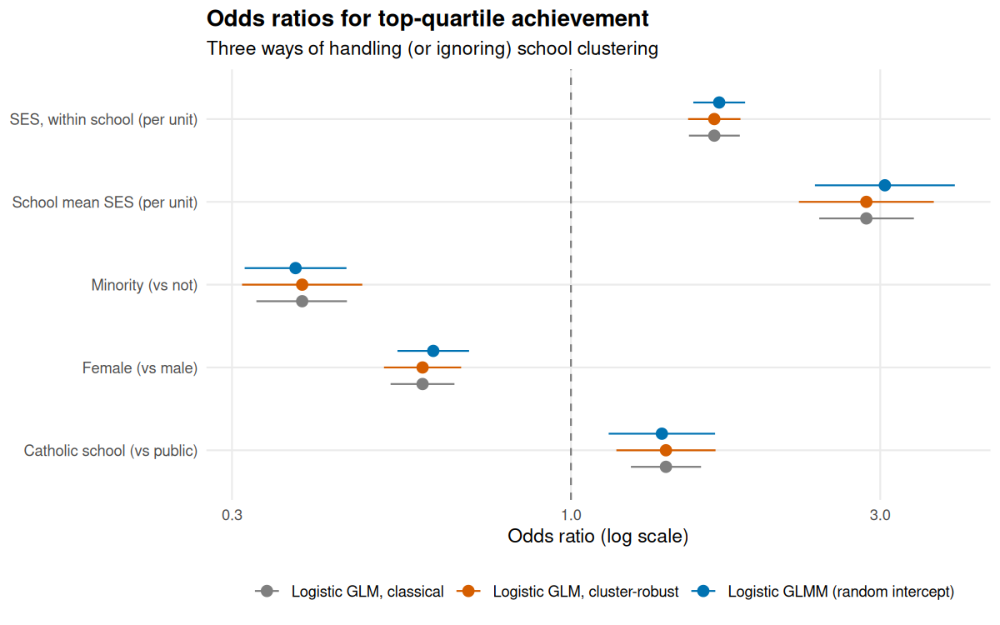


```r
tau2_g <- as.numeric(VarCorr(gm)$School)
icc_g  <- tau2_g / (tau2_g + pi^2 / 3)
```

The random-intercept variance is 0.17 (SD 0.41), giving a latent-scale ICC of 0.048. Compared with the classical GLM, the GLMM and cluster-robust intervals are wider for the school-level predictors (school mean SES and sector), as in the linear case. The point estimates barely move: GLMM odds ratios differ from the GLM's by only a few percent, in either direction. In theory, GLM odds ratios are population-averaged and GLMM odds ratios are school-specific (conditional on the school effect), so they estimate slightly different quantities and the GLMM ones are expected to lie a little further from 1 when school heterogeneity is large. Here the school-intercept SD is modest, so that distinction is minor.

# 8. Bootstrap confidence intervals

Section 5 showed that classical intervals are too narrow when observations cluster. This section builds intervals that do not rely on those assumptions, and then checks by simulation which intervals can be trusted.

## 8.1 Cluster bootstrap vs naive bootstrap for the linear model

The **cluster bootstrap** resamples whole *schools* with replacement, preserving the within-school correlation. The **naive case bootstrap** resamples individual students, which breaks the clusters apart and should reproduce the classical (overconfident) intervals. Both use 2,000 replicates with percentile intervals.


```r
boot_cl   <- cluster_boot_ols(f_lm, hsb, "School", B = N_BOOT_CLUSTER, seed = SEED)
boot_case <- case_boot_ols(f_lm, hsb,             B = N_BOOT_CLUSTER, seed = SEED)

bs_cl   <- boot_summary(boot_cl,   coef(m_lm)) |> mutate(Method = "Cluster bootstrap (schools)")
bs_case <- boot_summary(boot_case, coef(m_lm)) |> mutate(Method = "Naive bootstrap (students)")
bs_all  <- bind_rows(bs_case, bs_cl) |> mutate(Term = pretty_term(term))
save_table(bs_all |> select(Term, Method, estimate, boot_se, ci_low, ci_high), "11_bootstrap_ols")

bs_wide <- bs_all |> filter(term != "(Intercept)") |>
  transmute(Term, Method, Estimate = estimate, `Boot SE` = boot_se,
            `95% CI` = sprintf("[%.2f, %.2f]", ci_low, ci_high)) |>
  arrange(factor(Method, levels = c("Naive bootstrap (students)", "Cluster bootstrap (schools)")))
knitr::kable(bs_wide, digits = 2, caption = "Percentile bootstrap intervals for OLS coefficients")
```


Table: Percentile bootstrap intervals for OLS coefficients

|Term                          |Method                      | Estimate| Boot SE|95% CI         |
|:-----------------------------|:---------------------------|--------:|-------:|:--------------|
|SES, within school (per unit) |Naive bootstrap (students)  |     1.92|    0.11|[1.70, 2.15]   |
|School mean SES (per unit)    |Naive bootstrap (students)  |     3.93|    0.20|[3.54, 4.33]   |
|Minority (vs not)             |Naive bootstrap (students)  |    -2.71|    0.17|[-3.04, -2.38] |
|Female (vs male)              |Naive bootstrap (students)  |    -1.37|    0.14|[-1.66, -1.10] |
|Catholic school (vs public)   |Naive bootstrap (students)  |     1.77|    0.16|[1.45, 2.09]   |
|SES, within school (per unit) |Cluster bootstrap (schools) |     1.92|    0.12|[1.69, 2.17]   |
|School mean SES (per unit)    |Cluster bootstrap (schools) |     3.93|    0.36|[3.24, 4.63]   |
|Minority (vs not)             |Cluster bootstrap (schools) |    -2.71|    0.26|[-3.23, -2.21] |
|Female (vs male)              |Cluster bootstrap (schools) |    -1.37|    0.20|[-1.77, -1.00] |
|Catholic school (vs public)   |Cluster bootstrap (schools) |     1.77|    0.28|[1.22, 2.29]   |


```r
bs_plot <- bs_all |> filter(term != "(Intercept)")
ggplot(bs_plot, aes(estimate, Term, colour = Method)) +
  geom_vline(xintercept = 0, linetype = 2, colour = "grey50") +
  geom_pointrange(aes(xmin = ci_low, xmax = ci_high), position = position_dodge(width = .5)) +
  scale_colour_manual(values = c("Naive bootstrap (students)" = "grey50",
                                 "Cluster bootstrap (schools)" = "#D55E00")) +
  labs(title = "Resampling schools, not students",
       x = "Coefficient (maths points)", y = NULL, colour = NULL) +
  theme(legend.position = "bottom")
```

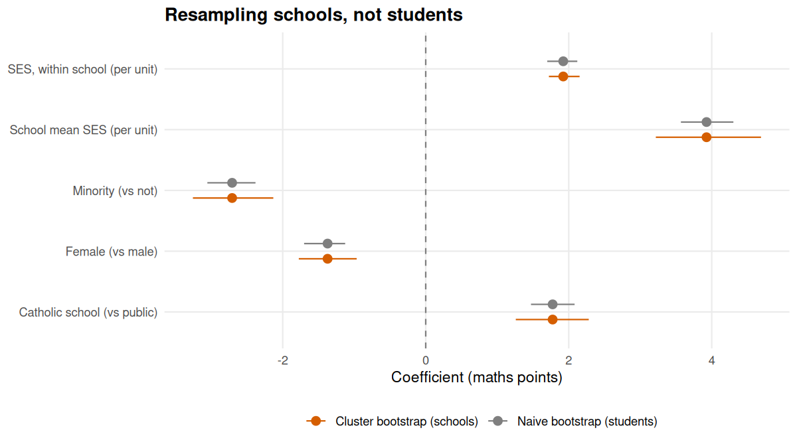

The naive bootstrap reproduces the classical standard errors (for example school mean SES: 0.202 vs classical 0.201), while the cluster bootstrap gives 0.357, matching the cluster-robust sandwich estimate (0.348) and the mixed-model SE (0.343).

## 8.2 Parametric bootstrap, profile and Wald intervals for the final mixed model

For the mixed model, the parametric bootstrap simulates new data from the fitted model, refits it, and takes percentiles of the refitted parameters (500 replicates). It also gives intervals for the variance components. These are compared with profile-likelihood and Wald intervals.


```r
ci_wald <- confint(m_final, method = "Wald")
ci_prof <- suppressWarnings(confint(m_final, method = "profile", quiet = TRUE))
ci_boot <- confint(m_final, method = "boot", nsim = N_BOOT_PARAM,
                   boot.type = "perc", seed = SEED, quiet = TRUE)

pars <- rownames(ci_prof)
est  <- c(.sig01 = sqrt(tau2), .sigma = sqrt(sig2), lme4::fixef(m_final))[pars]

fmt_ci <- function(ci, p) ifelse(is.na(ci[p, 1]), "", sprintf("[%.2f, %.2f]", ci[p, 1], ci[p, 2]))
lmm_ci_tab <- tibble(
  Parameter = ifelse(pars == ".sig01", "SD of school intercepts",
              ifelse(pars == ".sigma", "Residual SD", pretty_term(pars))),
  Estimate = unname(est),
  Wald = fmt_ci(ci_wald, pars), Profile = fmt_ci(ci_prof, pars), `Parametric bootstrap` = fmt_ci(ci_boot, pars)
)
save_table(lmm_ci_tab, "12_lmm_confidence_intervals")
knitr::kable(lmm_ci_tab, digits = 2, caption = "95% confidence intervals for the final mixed model")
```


Table: 95% confidence intervals for the final mixed model

|Parameter                           | Estimate|Wald           |Profile        |Parametric bootstrap |
|:-----------------------------------|--------:|:--------------|:--------------|:--------------------|
|SD of school intercepts             |     1.34|               |[1.11, 1.55]   |[1.11, 1.58]         |
|Residual SD                         |     5.98|               |[5.88, 6.07]   |[5.88, 6.08]         |
|Intercept                           |    13.31|[12.91, 13.70] |[12.91, 13.70] |[12.90, 13.70]       |
|SES, within school (per unit)       |     2.58|[2.29, 2.88]   |[2.29, 2.88]   |[2.26, 2.88]         |
|Catholic school (vs public)         |     1.71|[1.16, 2.25]   |[1.16, 2.25]   |[1.17, 2.24]         |
|School mean SES (per unit)          |     4.05|[3.38, 4.72]   |[3.38, 4.72]   |[3.37, 4.71]         |
|Minority (vs not)                   |    -2.77|[-3.17, -2.38] |[-3.17, -2.38] |[-3.21, -2.43]       |
|Female (vs male)                    |    -1.22|[-1.54, -0.91] |[-1.54, -0.91] |[-1.53, -0.88]       |
|Within-school SES x Catholic        |    -1.44|[-1.89, -0.99] |[-1.89, -0.99] |[-1.89, -0.99]       |
|Within-school SES x School mean SES |     1.00|[0.44, 1.56]   |[0.44, 1.56]   |[0.45, 1.62]         |

All three methods agree closely for the fixed effects, which is reassuring: with 160 schools and about 7,000 students the sampling distributions are close to normal. The Wald interval for the school-intercept SD is unavailable, which is why variance components are better handled with profile or bootstrap intervals.

## 8.3 Bootstrap interval for the intraclass correlation

The ICC is a ratio of variance components, so a normal-theory interval is awkward. The parametric bootstrap handles it directly:


```r
icc_fun <- function(fit) {
  v <- as.data.frame(VarCorr(fit))$vcov
  v[1] / sum(v)
}
set.seed(SEED)
bb <- lme4::bootMer(m0, icc_fun, nsim = N_BOOT_PARAM, type = "parametric")
icc_ci <- quantile(bb$t, c(.025, .975))
```

The null-model ICC is **0.18** with a 95% parametric-bootstrap interval of **[0.143, 0.219]**: between about 14% and 22% of the variance in maths achievement lies between schools.

## 8.4 Which intervals can be trusted? A coverage simulation

A 95% interval should contain the true value in 95% of repeated samples. This can be tested by simulating many data sets from a model whose true parameters are known. New data are drawn from the fitted random-intercept model M1 (with a fresh set of random school effects each time), and the OLS coefficients are re-estimated with three kinds of interval: classical, cluster-robust ($t$ with 159 df) and cluster-bootstrap. The simulation uses 500 data sets and 300 bootstrap replicates per data set.


```r
sim <- coverage_simulation(m1_reml, f_lm, hsb, "School", n_sim = N_SIM_COVERAGE, B = 300, seed = SEED)
cov_tab <- summarise_coverage(sim) |>
  mutate(Term = pretty_term(term),
         method = recode(method, naive = "Classical", cluster = "Cluster-robust", boot = "Cluster bootstrap")) |>
  filter(term != "(Intercept)")
save_table(cov_tab, "13_coverage_simulation")

cov_wide <- cov_tab |>
  select(Term, method, coverage) |>
  pivot_wider(names_from = method, values_from = coverage) |>
  select(Term, Classical, `Cluster-robust`, `Cluster bootstrap`)
knitr::kable(cov_wide, digits = 3,
  caption = sprintf("Empirical coverage of nominal 95%% intervals (%d simulated data sets; Monte Carlo SE about 1 point)", N_SIM_COVERAGE))
```


Table: Empirical coverage of nominal 95% intervals (500 simulated data sets; Monte Carlo SE about 1 point)

|Term                          | Classical| Cluster-robust| Cluster bootstrap|
|:-----------------------------|---------:|--------------:|-----------------:|
|Minority (vs not)             |     0.862|          0.958|             0.948|
|Catholic school (vs public)   |     0.732|          0.954|             0.942|
|Female (vs male)              |     0.880|          0.962|             0.968|
|SES, within school (per unit) |     0.964|          0.964|             0.968|
|School mean SES (per unit)    |     0.740|          0.944|             0.934|


```r
ggplot(cov_tab, aes(coverage, Term, colour = method)) +
  geom_vline(xintercept = .95, linetype = 2) +
  geom_point(size = 3, position = position_dodge(width = .5)) +
  scale_colour_manual(values = c(Classical = "grey50", `Cluster-robust` = "#D55E00", `Cluster bootstrap` = "#0072B2")) +
  scale_x_continuous(labels = scales::percent, limits = c(.5, 1)) +
  labs(title = "Empirical coverage of nominal 95% confidence intervals", x = "Coverage", y = NULL, colour = NULL) +
  theme(legend.position = "bottom")
```

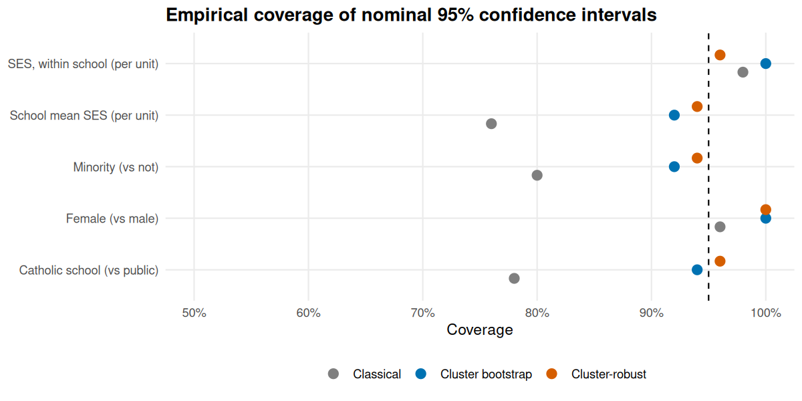


The classical interval for the Catholic-sector effect covers the truth only 73% of the time, and for school mean SES 74%, far below 95%. The cluster-robust and cluster-bootstrap intervals come much closer to the nominal level (95% and 94% for sector). With only 160 schools the bootstrap can be very slightly liberal, which is the usual small-cluster limitation. This simulation is the direct evidence for the claim that classical inference is unreliable here and cluster-aware inference is not.

# 9. Multiple testing

Whenever many hypotheses are tested, some will look significant by chance: at $\alpha = 0.05$, 5% of true nulls are rejected. Two procedure families are compared:

* **Family-wise error rate (FWER)**: Bonferroni and Holm control the probability of *any* false rejection. Holm is uniformly more powerful than Bonferroni.
* **False discovery rate (FDR)**: Benjamini-Hochberg (BH) controls the expected *proportion* of false rejections among rejections, trading some false positives for power; Benjamini-Yekutieli (BY) is valid under arbitrary dependence and more conservative.

## 9.1 Do any of the 160 schools have an unusual SES slope?

A natural family of 160 tests: for each school, is its SES-achievement slope different from the pooled within-school slope? Each school is fitted separately, and its slope is compared with the pooled slope using a $t$ test.


```r
pooled_slope <- unname(coef(lm(MathAch ~ ses_c + School, data = hsb))["ses_c"])

school_slopes <- hsb |>
  group_by(School, Sector) |>
  group_modify(~ {
    s <- summary(lm(MathAch ~ ses_c, data = .x))$coefficients
    tibble(n = nrow(.x), slope = s["ses_c", 1], se = s["ses_c", 2])
  }) |>
  ungroup() |>
  mutate(t = (slope - pooled_slope) / se,
         p_raw = 2 * pt(abs(t), df = n - 2, lower.tail = FALSE)) |>
  adjust_pvalues()
save_table(school_slopes, "14_school_slope_tests")

disc_schools <- count_discoveries(school_slopes)
save_table(disc_schools, "15_school_slope_discoveries")
knitr::kable(disc_schools |> rename(Procedure = procedure, `Schools flagged` = rejected, `Out of` = of),
             caption = "Schools whose SES slope differs from the pooled slope (alpha = 0.05)")
```


Table: Schools whose SES slope differs from the pooled slope (alpha = 0.05)

|Procedure                 | Schools flagged| Out of|
|:-------------------------|---------------:|------:|
|Unadjusted                |              12|    160|
|Bonferroni (FWER)         |               1|    160|
|Holm (FWER)               |               1|    160|
|Benjamini-Hochberg (FDR)  |               1|    160|
|Benjamini-Yekutieli (FDR) |               0|    160|


```r
school_slopes <- school_slopes |> mutate(flag = case_when(p_holm < .05 ~ "Significant after Holm",
                                                          p_raw < .05  ~ "Significant only unadjusted",
                                                          TRUE ~ "Not significant"))
p_hist <- ggplot(school_slopes, aes(p_raw)) +
  geom_histogram(breaks = seq(0, 1, .1), fill = "grey60", colour = "white") +
  geom_hline(yintercept = nrow(school_slopes) / 10, linetype = 2, colour = "#D55E00") +
  labs(title = "Distribution of the 160 p-values",
       subtitle = "Dashed line = flat histogram expected if every null were true",
       x = "Unadjusted p-value", y = "Schools")

se_grid <- tibble(se = seq(0, max(school_slopes$se), length.out = 100))
p_funnel <- ggplot(school_slopes, aes(se, slope)) +
  geom_ribbon(data = se_grid, aes(x = se, ymin = pooled_slope - 1.96 * se, ymax = pooled_slope + 1.96 * se),
              inherit.aes = FALSE, fill = "grey90") +
  geom_hline(yintercept = pooled_slope, colour = "grey40") +
  geom_point(aes(colour = flag), size = 1.8) +
  scale_colour_manual(values = c("Not significant" = "grey50", "Significant only unadjusted" = "#E69F00",
                                 "Significant after Holm" = "#D55E00")) +
  labs(title = "School SES slopes (funnel plot)", subtitle = "Grey band = 95% region around the pooled slope",
       x = "Standard error of school slope", y = "School SES slope", colour = NULL) +
  theme(legend.position = "bottom")
p_hist | p_funnel
```

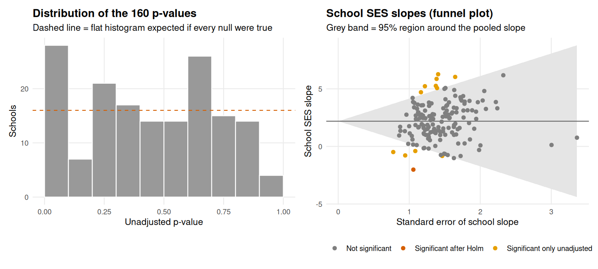


12 of 160 schools are flagged unadjusted (about 8 are expected by chance alone), but only 1 after Holm and Bonferroni, 1 after BH, and 0 after BY. The p-value histogram is not perfectly flat: there is a mild excess of small p-values (the first bin holds 28 schools against 16 expected), which points to a small amount of real slope variation. That fits the borderline random-slope test in Section 6.1 (M1 vs M2, p about 0.05), and Section 6.1 also showed that this variation is accounted for by sector and school SES. The per-school tests here do not condition on those, and each school has only about 45 students, so no individual school stands out once multiplicity is controlled. Testing all 160 schools without correction would have produced a list of "unusual" schools that is largely false positives.

## 9.2 Is the Catholic-school advantage the same in every subgroup?

The question "for whom is the sector gap present?" invites subgroup fishing. Here the family is fixed in advance: 12 subgroups defined by sex (2) × minority status (2) × tertile of student SES (3). In each, the Catholic-vs-public difference is estimated adjusting for school mean SES, with school-clustered robust standard errors.


```r
hsb <- hsb |>
  mutate(ses_group = cut(SES, quantile(SES, c(0, 1/3, 2/3, 1)), include.lowest = TRUE,
                         labels = c("Low SES", "Mid SES", "High SES")))

subgroups <- hsb |>
  group_by(Sex, Minority, ses_group) |>
  group_modify(~ {
    f  <- lm(MathAch ~ Sector + ses_mean, data = .x)
    ct <- lmtest::coeftest(f, vcov. = sandwich::vcovCL(f, cluster = .x$School, type = "HC1"))
    tibble(n = nrow(.x), n_schools = n_distinct(.x$School),
           estimate = ct["SectorCatholic", 1], se = ct["SectorCatholic", 2],
           p_raw = ct["SectorCatholic", 4])
  }) |>
  ungroup() |>
  adjust_pvalues()
save_table(subgroups, "16_subgroup_sector_gap")

sub_out <- subgroups |>
  transmute(Sex, Minority, `SES tertile` = ses_group, n, `Gap (points)` = estimate, SE = se,
            `p (raw)` = p_fmt(p_raw), `p (Holm)` = p_fmt(p_holm), `p (BH)` = p_fmt(p_bh))
knitr::kable(sub_out, digits = 2, caption = "Catholic - public gap in each subgroup, with adjusted p-values")
```


Table: Catholic - public gap in each subgroup, with adjusted p-values

|Sex    |Minority |SES tertile |    n| Gap (points)|   SE|p (raw) |p (Holm) |p (BH) |
|:------|:--------|:-----------|----:|------------:|----:|:-------|:--------|:------|
|Male   |No       |Low SES     |  581|         1.85| 0.68|0.006   |0.032    |0.010  |
|Male   |No       |Mid SES     |  863|         2.38| 0.62|<0.001  |0.001    |<0.001 |
|Male   |No       |High SES    | 1037|         0.24| 0.51|0.637   |1.000    |0.637  |
|Male   |Yes      |Low SES     |  467|         3.98| 0.65|<0.001  |<0.001   |<0.001 |
|Male   |Yes      |Mid SES     |  264|         1.70| 0.91|0.065   |0.247    |0.078  |
|Male   |Yes      |High SES    |  178|         4.45| 1.27|<0.001  |0.004    |0.001  |
|Female |No       |Low SES     |  782|         2.74| 0.58|<0.001  |<0.001   |<0.001 |
|Female |No       |Mid SES     |  989|         1.58| 0.42|<0.001  |0.002    |<0.001 |
|Female |No       |High SES    |  959|        -0.24| 0.40|0.546   |1.000    |0.596  |
|Female |Yes      |Low SES     |  566|         3.10| 0.69|<0.001  |<0.001   |<0.001 |
|Female |Yes      |Mid SES     |  297|         3.15| 1.10|0.004   |0.027    |0.008  |
|Female |Yes      |High SES    |  202|         1.74| 0.93|0.062   |0.247    |0.078  |


```r
disc_sub <- count_discoveries(subgroups)
save_table(disc_sub, "17_subgroup_discoveries")
knitr::kable(disc_sub |> rename(Procedure = procedure, `Subgroups flagged` = rejected, `Out of` = of))
```


|Procedure                 | Subgroups flagged| Out of|
|:-------------------------|-----------------:|------:|
|Unadjusted                |                 8|     12|
|Bonferroni (FWER)         |                 6|     12|
|Holm (FWER)               |                 8|     12|
|Benjamini-Hochberg (FDR)  |                 8|     12|
|Benjamini-Yekutieli (FDR) |                 8|     12|


```r
subgroups |>
  mutate(Group = paste(Sex, ifelse(Minority == "Yes", "minority", "non-minority")),
         Result = ifelse(p_holm < .05, "Significant after Holm", "Not significant after Holm")) |>
  ggplot(aes(ses_group, estimate, colour = Result)) +
  geom_hline(yintercept = 0, linetype = 2) +
  geom_pointrange(aes(ymin = estimate - 1.96 * se, ymax = estimate + 1.96 * se)) +
  facet_wrap(~ Group, nrow = 1) +
  scale_colour_manual(values = c("Significant after Holm" = "#D55E00", "Not significant after Holm" = "grey50")) +
  labs(title = "Catholic-school advantage by subgroup",
       subtitle = "Estimates with 95% cluster-robust intervals (unadjusted for multiplicity)",
       x = NULL, y = "Catholic - public (maths points)", colour = NULL) +
  theme(legend.position = "bottom", axis.text.x = element_text(angle = 30, hjust = 1))
```

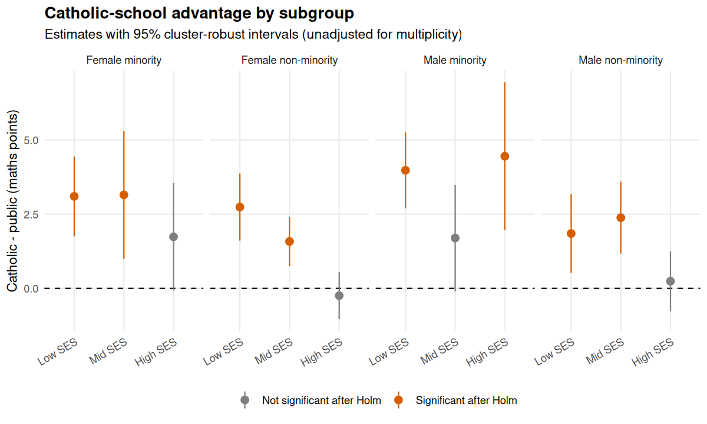

The Catholic advantage is positive in 11 of 12 subgroups and is clearest for low-SES students (significant in all four sex-by-minority groups even after correction). It is essentially absent for high-SES non-minority students, matching the flatter SES gradient found in the mixed model; the minority subgroups are noisier because they are small. Of the 8 subgroups significant unadjusted, Bonferroni keeps 6, while Holm (same FWER guarantee, more power) and both FDR procedures keep 8. The borderline subgroups (for example the mid-SES minority groups, with raw p about 0.06) are where the choice of correction matters, so the correction should be chosen before looking at the results.

# 10. Interpretation and limitations

**What the analysis supports.**

* Student SES, school mean SES, minority status, sex and school sector are all associated with maths achievement, and conclusions are consistent across the continuous outcome (linear models) and the binary outcome (logistic models).
* School clustering is substantial (ICC 0.18). Methods that ignore it give intervals that are too narrow for school-level predictors, and by simulation the classical intervals fail to achieve 95% coverage. Mixed models, cluster-robust SEs and cluster bootstrap agree with one another.
* The advantage of Catholic schools is conditional: it is largest for lower-SES students, and the SES gradient is flatter in Catholic schools.
* Apart from sector and school SES, schools do not differ detectably in their SES slopes.

**Limitations.**

* **Association, not causation.** Students are not randomly assigned to schools. The sector coefficient may reflect selection (families who choose Catholic schools differ in ways beyond SES), so it should not be read as the causal effect of attending a Catholic school.
* **Old, specific data.** HSB is a 1982 US survey. The methods transfer; the substantive numbers should not be extrapolated to other places or years.
* **Dichotomised outcome.** Top-quartile status discards information and depends on the cut-off; the linear mixed models are the primary analysis.
* **Sampling design.** Survey weights and the original sampling design were not used. Estimates describe the sample, and design-based inference would require the weights.
* **Limited predictors.** SES is a single index; prior achievement, peer composition and curriculum are not available. Residual confounding is likely.
* **Per-school slope tests have low power** (about 45 students each), so "no school flagged" means "no strong evidence", not "all schools are identical".
* **Few Catholic minority students** in some subgroups, so subgroup estimates are imprecise.

**Possible extensions.** Weighted analysis using sampling weights, a three-level model, random slopes for sex or minority status, a Bayesian multilevel model for partial pooling of school effects, or applying the same pipeline to a health or housing dataset.

# 11. Reproducibility

Everything is driven by `run_all.R`; random seeds are fixed (`SEED = r SEED`) and all outputs (tables and figures) are written to `outputs/`.


```r
sessionInfo()
```

```
## R version 4.3.3 (2024-02-29)
## Platform: x86_64-pc-linux-gnu (64-bit)
## Running under: Ubuntu 24.04.5 LTS
## 
## Matrix products: default
## BLAS:   /usr/lib/x86_64-linux-gnu/blas/libblas.so.3.12.0 
## LAPACK: /usr/lib/x86_64-linux-gnu/lapack/liblapack.so.3.12.0
## 
## locale:
## [1] C
## 
## time zone: Etc/UTC
## tzcode source: system (glibc)
## 
## attached base packages:
## [1] stats     graphics  grDevices utils     datasets  methods   base     
## 
## other attached packages:
##  [1] patchwork_1.2.0 lme4_1.1-35.1   Matrix_1.6-5    lubridate_1.9.3
##  [5] forcats_1.0.0   stringr_1.5.1   dplyr_1.1.4     purrr_1.0.2    
##  [9] readr_2.1.5     tidyr_1.3.1     tibble_3.2.1    ggplot2_3.4.4  
## [13] tidyverse_2.0.0
## 
## loaded via a namespace (and not attached):
##  [1] gtable_0.3.4        xfun_0.41           bslib_0.6.1        
##  [4] lattice_0.22-5      tzdb_0.4.0          vctrs_0.6.5        
##  [7] tools_4.3.3         generics_0.1.3      sandwich_3.1-0     
## [10] parallel_4.3.3      fansi_1.0.5         highr_0.10         
## [13] pkgconfig_2.0.3     lifecycle_1.0.4     compiler_4.3.3     
## [16] farver_2.1.1        munsell_0.5.0       codetools_0.2-19   
## [19] carData_3.0-5       htmltools_0.5.7     sass_0.4.8         
## [22] yaml_2.3.8          furrr_0.3.1         pillar_1.9.0       
## [25] car_3.1-2           nloptr_2.0.3        crayon_1.5.2       
## [28] jquerylib_0.1.4     MASS_7.3-60.0.1     ellipsis_0.3.2     
## [31] broom.mixed_0.2.9.4 cachem_1.0.8        abind_1.4-5        
## [34] boot_1.3-30         parallelly_1.37.1   nlme_3.1-164       
## [37] tidyselect_1.2.0    digest_0.6.34       future_1.33.1      
## [40] stringi_1.8.3       listenv_0.9.1       labeling_0.4.3     
## [43] splines_4.3.3       fastmap_1.1.1       grid_4.3.3         
## [46] colorspace_2.1-0    cli_3.6.2           magrittr_2.0.3     
## [49] utf8_1.2.4          broom_1.0.5         withr_2.5.0        
## [52] scales_1.3.0        backports_1.4.1     bit64_4.0.5        
## [55] timechange_0.3.0    rmarkdown_2.25      globals_0.16.2     
## [58] bit_4.0.5           zoo_1.8-12          hms_1.1.3          
## [61] evaluate_0.23       knitr_1.45          lmtest_0.9-40      
## [64] mgcv_1.9-1          rlang_1.1.3         Rcpp_1.0.12        
## [67] glue_1.7.0          vroom_1.6.5         minqa_1.2.6        
## [70] jsonlite_1.8.8      R6_2.5.1
```
